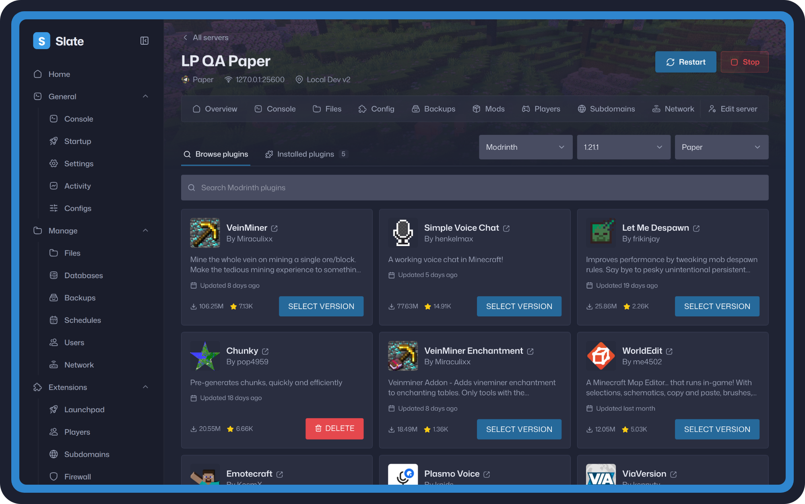
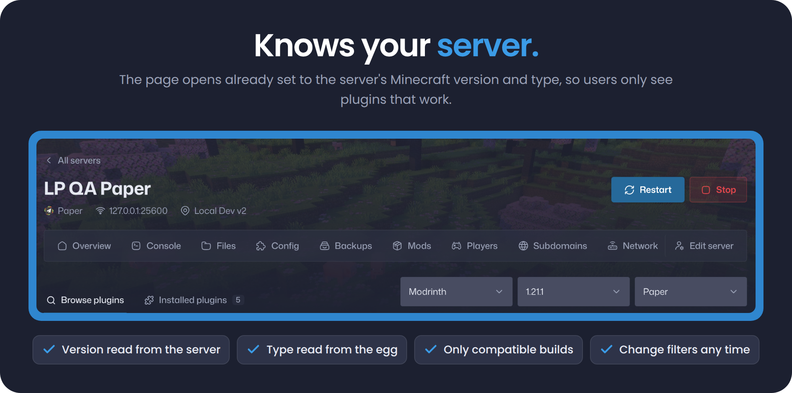
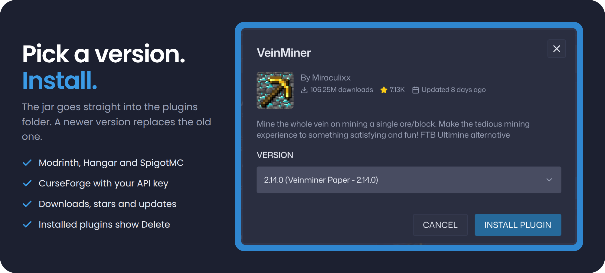
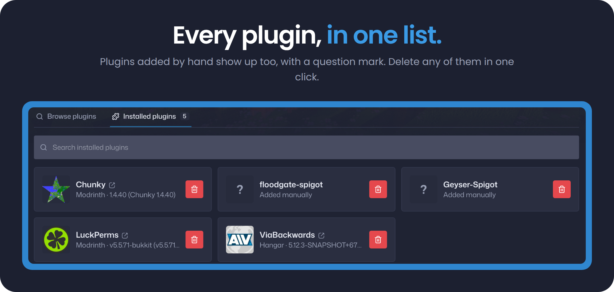

# Minecraft Plugin Installer

A free Pterodactyl v2 extension. Users find and install Minecraft plugins from Modrinth, Hangar, SpigotMC and CurseForge right from the panel.






## Install

Upload the `.pteroext` in the panel under Extensions, or run:

```
php artisan p:extension:install plugin-installer.pteroext --enable --replace
```

## Set up

- Pick which eggs show the Plugins page in the extension settings.
- Add a CurseForge API key there to turn on CurseForge.


